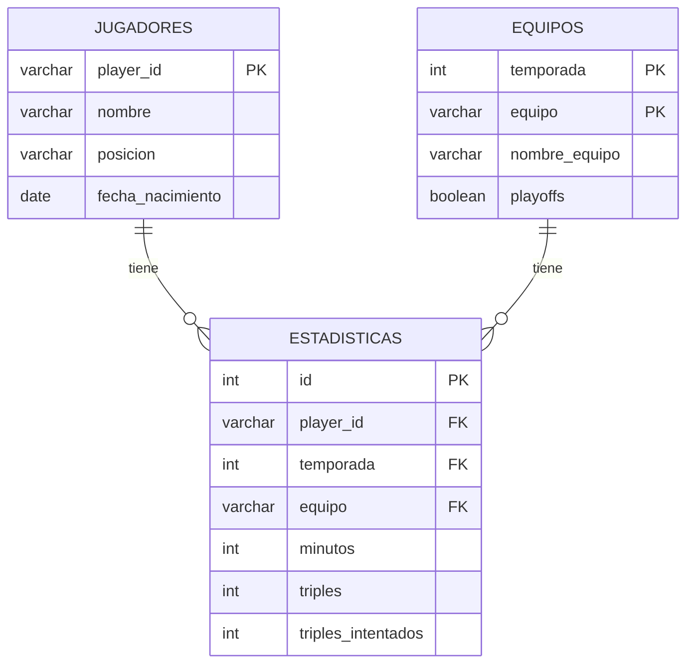

# NBA: triples por minuto jugado

Mini proyecto "SQL: From Data to Insight" · Ironhack Data Analytics

**Autores:** Juan y Jordi

## Pregunta
¿Qué jugador ha metido más triples en relación al tiempo jugado en la historia de la NBA?

## Datos
[NBA Stats (1947-present)](https://www.kaggle.com/datasets/sumitrodatta/nba-aba-baa-stats), de Kaggle.

## Stack
MySQL + Python (pandas, SQLAlchemy)

## Hipótesis
Stephen Curry es el jugador con más triples por cada 36 minutos jugados.

## Estructura
```
nba-sql-project/
├── data/
│   ├── raw/        CSV originales (no se suben, se descargan con el script)
│   └── clean/      tablas limpias que genera 02_limpieza
├── notebooks/
│   ├── 01_exploracion.ipynb   primer vistazo a los 22 CSV
│   ├── 02_limpieza.ipynb      filtros y tablas limpias
│   ├── 03_base_datos.ipynb    crea la base de datos en MySQL y carga los datos
│   └── 04_consultas.ipynb     consultas y conclusiones
├── sql/
│   ├── 01_esquema.sql         tablas jugadores, equipos y estadisticas
│   └── 02_consultas.sql       las consultas para lanzarlas en MySQL Workbench
├── src/
│   └── download_data.py
├── .env.example
└── requirements.txt
```

## Cómo ejecutarlo
1. Instalar las librerías: `pip install -r requirements.txt`
2. Descargar los datos: `python src/download_data.py`
3. Copiar `.env.example` como `.env` y poner el usuario y la contraseña de MySQL.
4. Ejecutar los notebooks en orden: 02, 03 y 04.

## Limpieza
- Solo la liga NBA (el dataset incluye también la ABA y la BAA).
- Solo desde la temporada 1980, la primera con línea de tres.
- Los jugadores traspasados tienen una fila por equipo y otra con el total (`2TM`, `3TM`...). Quitamos las de total para no contar sus triples dos veces.
- En el ranking exigimos un mínimo de minutos en la carrera.

## Base de datos


## Resultados
- Stephen Curry es el primero con 4,22 triples por cada 36 minutos, y sigue primero con mínimos de 5.000, 10.000 y 20.000 minutos.
- Detrás de él el ranking cambia según el mínimo: con 5.000 minutos aparecen especialistas como Isaiah Joe o Troy Daniels; con 20.000, Buddy Hield y Klay Thompson.
- La liga pasó de 0,15 triples por cada 36 minutos en los años 80 a 1,91 en los 2020.
- Entre los 50 mejores tiradores por minuto, la mayoría son bases y escoltas.

Son relaciones entre datos, no causas. Los jugadores recientes salen favorecidos porque hoy se tira mucho más de tres.
